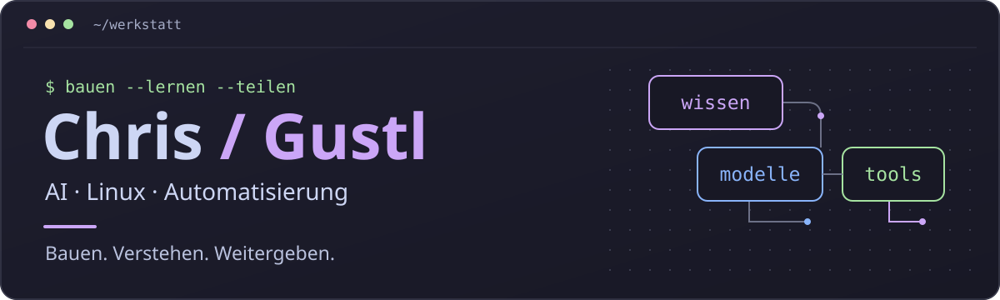

  

  <strong>Weniger Handarbeit. Mehr verstehen, wie es funktioniert.</strong> 
  Ich verbinde AI, Linux und Automatisierung zu Werkzeugen für meinen Alltag.

  <a href="#aus-meiner-werkstatt">Projekte entdecken</a> ·
  <a href="#woran-ich-arbeite">Aktueller Fokus</a> ·
  <a href="https://huggingface.co/Gustlson">Hugging Face</a> ·
  <a href="#austausch">Austausch</a>

## Moin, ich bin Chris 👋

Auch als **Gustl** unterwegs. Ich begann als Mechaniker und wurde später Werkstattleiter. Eine Cloud-Weiterbildung führte mich zu DevOps; meine Terminal-Affinität hatte ich schon immer – am Terminal ist der Weg für mich einfach direkter. Mein Einstieg in AI war Odysseus, heute nutze ich Hermes.

Hier findest du meine Projekte rund um **lokale AI, Agents und Automatisierung** – mit den Lösungen und Fallstricken, die beim Bauen entstehen. Mein Ziel ist, praktische AI auch für kleine Unternehmen, Handwerk und NGOs zugänglich zu machen.

## Aus meiner Werkstatt

### [AI Knowledge Ecosystem](https://github.com/ChristianGruend/ai-knowledge-ecosystem)

**Neuer Chat, wieder alles erklären?** Ich halte meinen Arbeitskontext in Markdown fest und verwende ihn über mehrere AI-Tools hinweg. Eine Python-Pipeline verarbeitet zusätzlich Chat-Exporte zu Wissensbausteinen und System-Prompts.

Die öffentliche Version ist eine **Vorlage ohne persönliche Daten**. Das Memory nutze ich täglich; die Pipeline arbeitet mit Schlüsselwörtern und erkennt noch keine Widersprüche.

`Python` · `Markdown` · `AI Memory` · [Aufbau & Einstieg →](https://github.com/ChristianGruend/ai-knowledge-ecosystem#the-problem-i-had)

### Hermes Agent – mein Setup ([Upstream-Projekt](https://github.com/NousResearch/hermes-agent))

**Mein Haupt-Agent für den Alltag.** Ich verbinde Hermes unter Linux mit Cloud-Modellen und einem lokalen Ollama-Fallback. Über MCP erhält er Zugriff auf eigene Werkzeuge; Gateway, Dashboard und systemd machen daraus ein alltagstaugliches Setup.

`Hermes Agent` · `Ollama` · `MCP` · `Linux` · `systemd` · [Hermes Agent ansehen →](https://github.com/NousResearch/hermes-agent)

### [AX206 Neon Dashboard](https://github.com/ChristianGruend/ax206-neon-dashboard)

**Ein USB-Bilderrahmen als Systemmonitor.** CPU-Threads, GPU, RAM und Dienste werden auf einem kleinen Display sichtbar. Ein Python-Collector sammelt die Werte, ein Generator baut das Layout für lcd4linux. Eine Vorschau funktioniert auch ohne das Gerät.

`Python` · `Linux` · `systemd` · `lcd4linux` · [Dashboard ansehen →](https://github.com/ChristianGruend/ax206-neon-dashboard#ax206-neon-dashboard)

### [AMD ROCm KI-Umgebung](https://github.com/ChristianGruend/amd-rocm-ki-umgebung)

**Lokale AI auf vorhandener AMD-Hardware ausprobieren.** Mein Docker-Compose-Setup verbindet Ollama, PyTorch und Jupyter Lab mit ROCm. Dazu gibt es Hinweise zur GPU-Auswahl und zur Fehlersuche.

`Docker Compose` · `Ollama` · `AMD ROCm` · [Setup ansehen →](https://github.com/ChristianGruend/amd-rocm-ki-umgebung)

<strong>Außerdem: mein Odysseus-Fork</strong>

Mit [Odysseus](https://github.com/ChristianGruend/odysseus) habe ich einen selbst gehosteten AI-Workspace um Sprachdienste, Bildgenerierung und MCP-Anbindungen ergänzt. Er basiert auf dem [Upstream-Projekt](https://github.com/pewdiepie-archdaemon/odysseus).

Das Setup ist inzwischen pausiert. Als Haupt-Agent nutze ich jetzt [Hermes Agent](https://github.com/NousResearch/hermes-agent).

[Alle öffentlichen Repositories →](https://github.com/ChristianGruend?tab=repositories)

## Woran ich arbeite

- **Agents im Alltag:** Hermes mit Cloud-Modell und lokalem Fallback über Ollama im eigenen Setup einsetzen.
- **Tools verbinden:** Agents über MCP und APIs mit Funktionen versorgen; Sprache und Automatisierung in den Alltag einbauen.
- **Kontext behalten:** Wissen zwischen AI-Tools und Rechnern wiederverwenden und das Memory überschaubar halten.
- **Security vertiefen:** DevSecOps, SOC/SIEM und Zero Trust als Lernfelder mit meinen praktischen Projekten verbinden.

## Werkzeuge & Hintergrund

| Bereich | Womit ich arbeite |
| :--- | :--- |
| **AI & Modelle** | Hermes Agent · Ollama · Hugging Face · AMD ROCm · MCP · Voice AI |
| **AI beim Entwickeln** | Claude Code · Codex · Kimi Code |
| **Code & Automation** | Python · Bash · REST APIs · Git/GitHub · systemd · Cron |
| **Systeme & Betrieb** | Linux · Docker Compose · Zorin OS · Arch / Hyprland · Manjaro |
| **Cloud-/DevOps-Hintergrund** | AWS · Terraform · Kubernetes · CI/CD |

Linux auf dem Desktop, Catppuccin Mocha in den Configs — und meist ein Projekt, an dem es noch etwas zu verstehen gibt.

## Austausch

Du baust etwas mit lokaler AI, Linux oder Automatisierung? **Mich interessiert, was bei dir funktioniert – und wo es hakt.** Fragen, Erfahrungen und Verbesserungsvorschläge zu meinen Projekten passen in die jeweiligen Repository-Issues.

**[GitHub · ChristianGruend](https://github.com/ChristianGruend)** · **[Hugging Face · Gustlson](https://huggingface.co/Gustlson)**

---

⚡ **Wissen ist Macht.** Jahrtausendelang war beides ein Privileg — gehütet von Tempeln, Universitäten und Konzernen. Zum ersten Mal in der Geschichte der Menschheit steht das Wissen der Welt jedem offen. Macht bemisst sich nicht mehr an Herkunft oder Kapital, sondern an Neugier.
